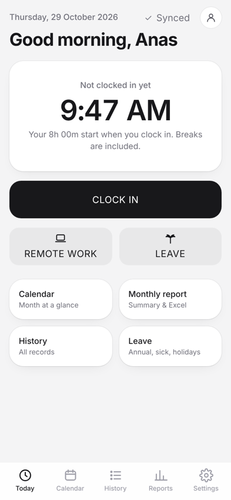
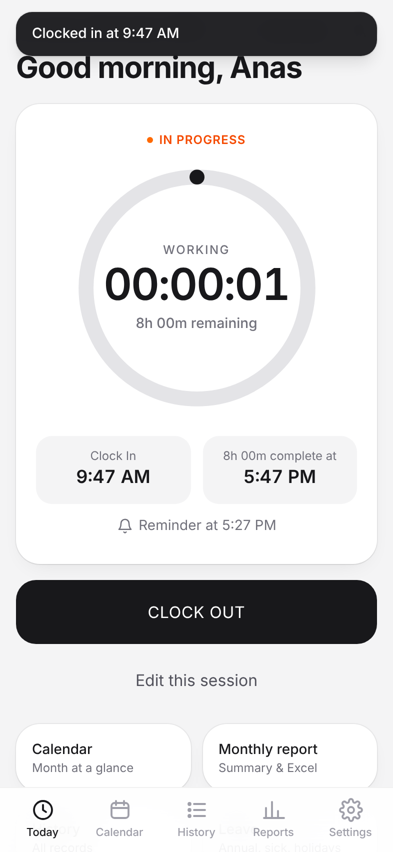
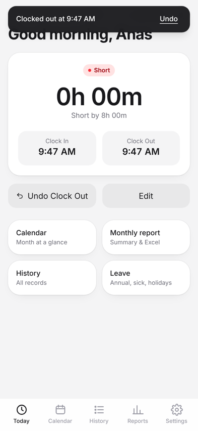
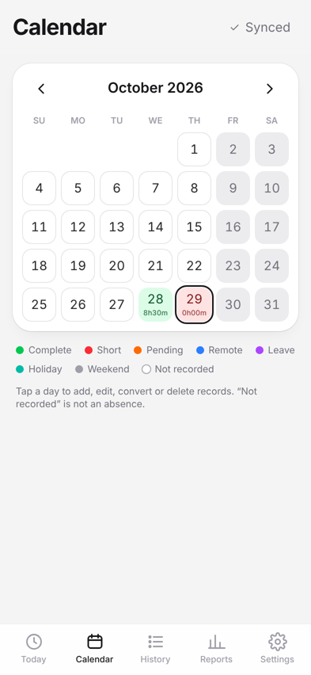
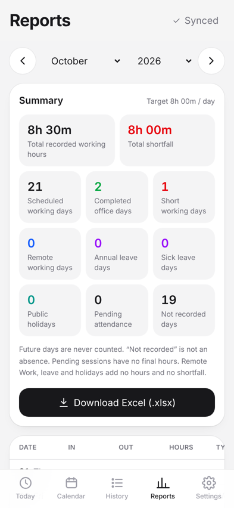

# Attendance — Personal Attendance Tracker (iPhone PWA)

A personal, multi-user attendance tracker that installs on the iPhone Home Screen.
Clock in / out, see a live timer against an 8-hour day (breaks included), get **one
push reminder 20 minutes before the 8 hours are up**, record remote work and leave,
and export monthly reports to Excel.

> Personal tool only. It does not connect to, read from, or change any employer
> attendance or biometric system.

| Today | Working | Done | Calendar | Reports |
|---|---|---|---|---|
|  |  |  |  |  |

## Features

- **Accounts** — sign up (name, email, password), log in, log out, forgot / reset password, persistent login. Every user's data is isolated by PostgreSQL Row Level Security. No admin dashboard.
- **Dashboard** — date, status, Clock In time, live timer, remaining time, expected completion, reminder time; only valid actions are shown.
- **Clock In / Clock Out** — exact timestamps, saved immediately; timer computed from the stored Clock In (survives closing, locking, restarting, switching devices). No capping at 8 h, no break deduction, never auto-closed. Duplicate taps and network retries cannot create duplicates.
- **Undo Clock Out** — restores the same session and its Clock In; no late reminder if its time has passed.
- **Reminder** — at Clock In + (duration − lead), i.e. 08:00 → **15:40** for 8 h / 20 min. Scheduled on the server, sent with Web Push to every registered device, cancelled on Clock Out, rescheduled on edits and settings changes, never sent twice or late.
- **Remote Work** — one tap; no hours invented; undo, move, convert to/from office attendance.
- **Conflict prevention** — a day can't be both office / remote / leave. A CANCEL / REPLACE dialog appears; replacing is one atomic database transaction (a partly-overlapping leave is trimmed, not lost).
- **Manual editing** — add, edit times or date, delete, change type; validated (no future times, Clock Out after Clock In, ≤ 24 h, no overlaps).
- **Forgotten Clock Out** — stays Pending (orange) and is flagged on the dashboard until fixed.
- **Leave** — Annual, Sick, Public Holiday; multi-day ranges; working-day counts exclude your weekend; no built-in holiday calendar.
- **Overnight sessions** — belong to the Clock In date; stored in UTC, shown in your timezone.
- **Calendar & colours** — Green ≥ target, Red < target, Orange pending, Blue remote, Purple leave, Teal holiday, Gray weekend, Neutral not recorded (never treated as absence; future days never counted).
- **Monthly report** — every required column and summary figure; **Excel (.xlsx)** export with status colours, frozen header, summary sheet.
- **Offline** — Clock In/Out, Undo and Remote Work work offline and show SAVED LOCALLY → SYNC PENDING → SYNCED (or SYNC FAILED with Retry / Replace / Discard). Other edits are disabled offline with an explanation.
- **Settings per user** — working duration, reminder lead time, working days, timezone; history keeps its original target unless you choose Recalculate.
- **Account** — edit name, change password, export all data, delete account (with export offer and typed confirmation).

## Architecture

```
iPhone (Home Screen PWA)                     Supabase (free tier)
┌──────────────────────────┐   HTTPS + JWT   ┌──────────────────────────────────────┐
│ React + TypeScript + TW  │ ──────────────▶ │ Auth   ·  PostgREST  ·  PostgreSQL     │
│ offline queue (local)    │                 │   tables + RLS + RPC functions         │
│ service worker (cache,   │                 │   triggers keep `reminders` correct    │
│   push display)          │                 │ pg_cron (every minute) ──▶ Edge Fn     │
└──────────▲───────────────┘                 │   send-reminders (VAPID Web Push)      │
           │   Apple / Google push service    └───────────────┬──────────────────────┘
           └──────────────────────────────────────────────────┘
Hosting: Cloudflare Pages (static)
```

- **No `setTimeout` for notifications.** A trigger writes one `reminders` row per session; `pg_cron` calls the Edge Function every minute; it claims due rows with `FOR UPDATE SKIP LOCKED` (no duplicates), skips anything more than 15 minutes late, and sends with a TTL that expires at the 8-hour mark.
- The frontend only ever has the public anon key. The service-role key, VAPID private key and cron secret live in Supabase secrets / Vault.

## Project layout

```
src/
  lib/            time.ts (timezones) · attendance.ts (rules) · sync.ts (offline queue)
                  api.ts · push.ts · excel.ts · errors.ts · types.ts
  state/          auth.tsx · data.tsx (snapshot + queue) · ui.tsx (toasts, dialogs)
  pages/          Dashboard · Calendar · History · Reports · Leave · Settings · Account · Install · Auth
  components/     Layout (tab bar, sync badge) · DayEditor · forms · ui · icons
  sw.ts           service worker (precache, push, notification click)
supabase/
  migrations/     20261029000001_schema.sql   ← schema, RLS, RPCs, triggers
  setup/cron.sql  every-minute scheduler (run after deploying the function)
  functions/send-reminders/   index.ts (Deno) · dispatch.ts · dispatch.test.ts
  tests/db.test.mjs           real-SQL tests (PGlite)
e2e/              mock-supabase.mjs · run_e2e.py (Playwright)
scripts/          generate-vapid-keys.mjs · generate-icons.mjs
```

## Getting started

1. Follow **[SETUP.md](SETUP.md)** (Supabase, SMTP, VAPID keys, Edge Function, scheduler, Cloudflare Pages, iPhone install).
2. Local development: `cp .env.example .env.local`, fill the three values, `npm install`, `npm run dev`.

## Scripts

| Command | Purpose |
|---|---|
| `npm run dev` / `build` / `preview` | Develop, type-check + build, preview the PWA |
| `npm test` | Unit tests (Vitest) |
| `npm run test:db` | Database tests on the real migration (PGlite) |
| `npm run test:push` | Edge Function tests (requires Deno) |
| `npm run test:e2e` | Browser tests (requires Python Playwright + Chromium) |
| `npm run vapid` | Generate VAPID keys |

Test results, known limitations and the implementation checklist: **[TESTING.md](TESTING.md)**.
